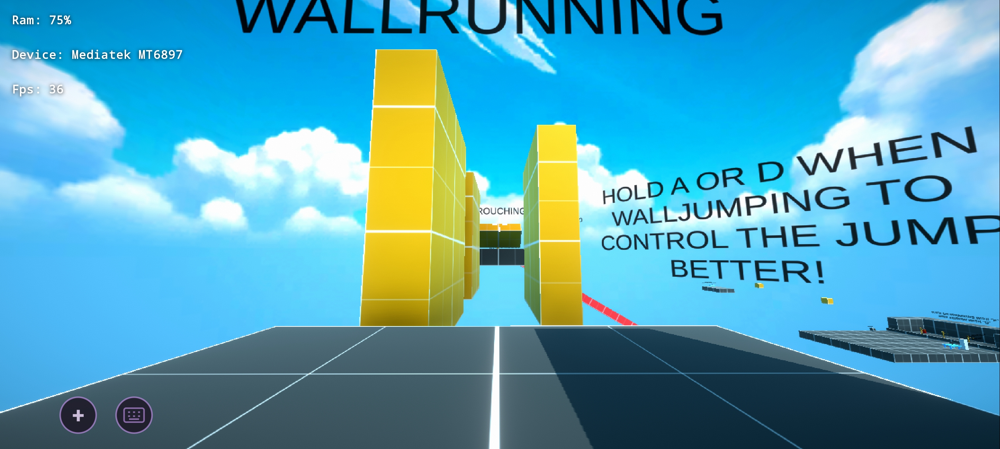
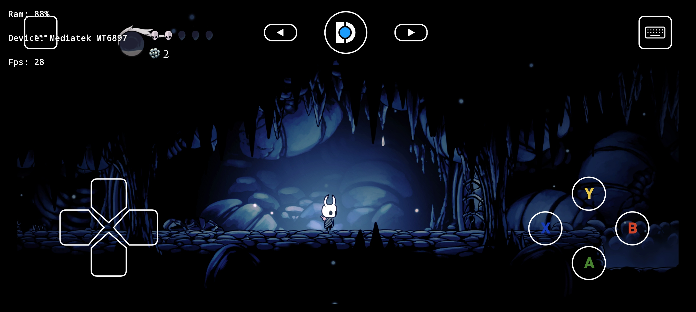
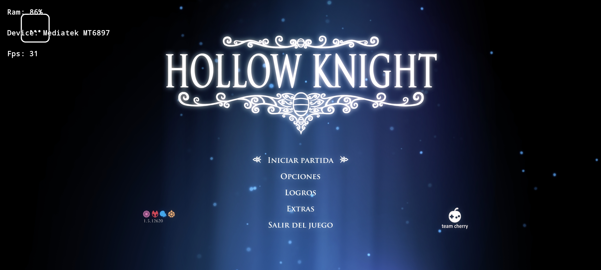
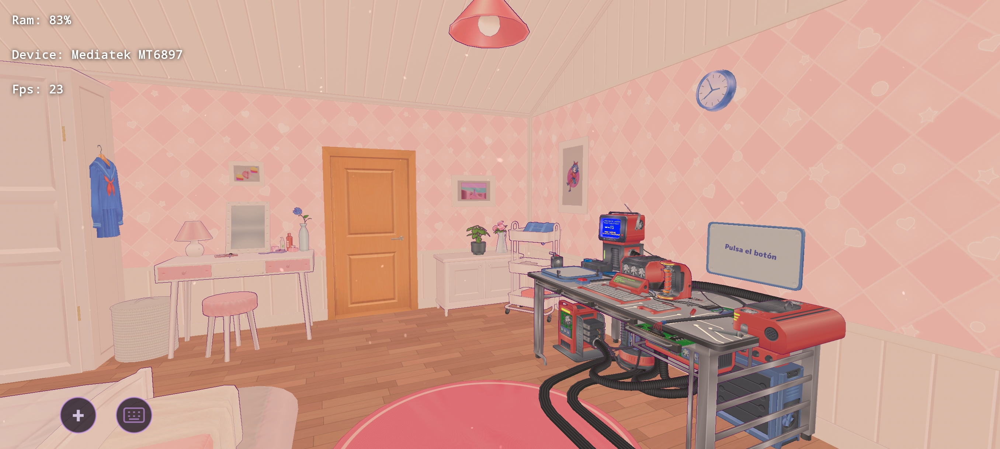
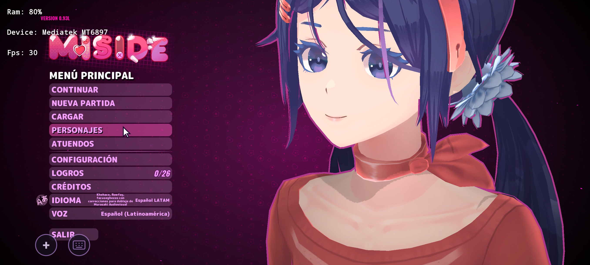
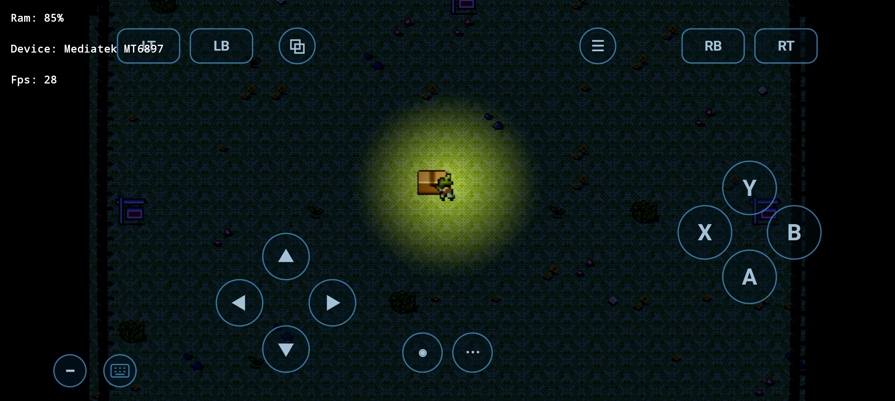
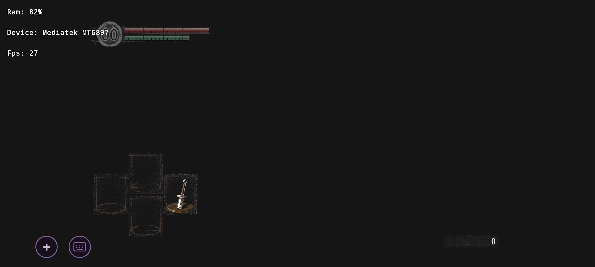

1

  <picture>
    <source media="(prefers-color-scheme: dark)" srcset="artwork/droiddeck-banner-dark.svg">
    
  </picture>

<h1 align="center">DroidDeck — Mali-G615 Experimental Fork</h1>

  <strong>SteamOS Gaming Mode (Gamescope + Big Picture), KDE Plasma Desktop &amp; Proton (ARM64EC + FEX / WOWBox64 + DXVK) on ARM Mali-G615 Android Devices</strong>

  
  
  

## Notice ⚠️ This project was made with AI 
---

## 📖 Overview / Descripción General

**DroidDeck-Mali** is an experimental fork of [DroidDeck](https://github.com/Droid-Deck/DroidDeck) engineered to run **Valve's Steam client (Gaming Mode & Desktop Mode)** and **Windows games via ARM64EC Proton (`DroidDeck-Proton` / `GE-Proton`), `FEX-Emu`, `WOWBox64`, and `DXVK`** on **ARM Mali-G615 (Valhall v10)** Android devices without root (developed and tested on **POCO X6 Pro / MediaTek Dimensity 8300-Ultra — Mali-G615 MC6, 8 GB RAM**).

Upstream DroidDeck targets Qualcomm Adreno GPUs (`kgsl` + Mesa Turnip) and blocks Mali GPUs. This fork introduces:
- **Direct `/dev/mali0` (`mali_kbase`) Hardware Vulkan Support** using [`panvk-kbase-android`](https://github.com/zenithblue-oss/panvk-kbase-android) (`v0.1.0-rc3`) paired with DroidDeck's custom **ICD DRM primary-node shim** (`libvulkan_mali_g615_stub.so`) so `gamescope` and `DXVK` can initialize hardware Vulkan without a kernel DRM render node.
- **CPU Software Vulkan Safety Mode (`lavapipe`)** so sessions can also boot with `/dev/mali0` completely isolated from the container.
- **Unified Memory Architecture (UMA) & RAM Optimizations** tailored for 8–12 GB Android devices running Steam + Gamescope + Wine/Proton simultaneously.
- **Universal Mali CSF adapter (0.2.0)**: the DRM-node shim and the session probe accept every ARM Mali the driver reports (CSF v9–v13: G57/G610/G710/G615/G715/G620/G720/G925), not only the `Mali-G615` this fork was validated on — a name-only gate left other Malis (e.g. the Immortalis-G925 in a Redmi Turbo 5 Max / POCO X8 Pro Max) a black session that died before `gamescope`. See [`docs/diagnostico-turbo5max-pantalla-negra.md`](docs/diagnostico-turbo5max-pantalla-negra.md) and [`tools/mali-driver/`](tools/mali-driver/).

---

## 📸 Galería / Gallery — v0.4.0-beta.1 en el POCO X6 Pro (Mali-G615 MC6)

Todo el álbum de esta versión en una sola tabla: los títulos probados con el mando virtual y el
HUD personalizable dibujándose en juego. HUD/Fps/RAM es la capa del propio fork.

| | |
|---|---|
|  **Karlson** — 36 fps, acelerado por la GPU Mali |  **Hollow Knight** — 28 fps con el mando virtual |
|  **Hollow Knight** — menú, 31 fps |  **MiSide** — 23 fps en partida |
|  **MiSide** — menú principal, 30 fps |  **Mando virtual completo** en juego 2D — 28 fps |
|  **Dark Souls** — menús e inventario OK (mundo en negro: error conocido) | |

---

## 🚀 Download & Installation / Descarga e Instalación

Download the latest release from **[Releases](https://github.com/jdmg28/DroidDeck-Mali/releases/latest)**.

### 📦 Release Assets (Separate Files — Do Not Unpack the Driver ZIPs!)

> ⚠️ **IMPORTANT / IMPORTANTE:**
> Each GPU driver is published as its own **separate `.zip` file** on the release page:
> - **`DroidDeck-Mali-CSF-PanVK-kbase-universal.zip`** *(Hardware GPU driver for Mali CSF GPUs — validated on Mali-G615, others experimental)*
> - **`DroidDeck-Software-Vulkan-lavapipe.zip`** *(CPU software Vulkan fallback driver)*
>
> **Do NOT extract these `.zip` files and do NOT bundle them inside another `.zip`.**
> Download the driver `.zip` you want and select that `.zip` file **directly** inside the DroidDeck app under **`Components` → `GPU drivers` → `Import`**.
>
> **NO descomprimas los archivos `.zip` de los drivers.** Descarga el archivo `.zip` del driver que necesites e impórtalo **directamente tal cual** dentro de la app DroidDeck en **`Components` → `GPU drivers` → `Import`**.

### Step-by-Step Setup / Pasos de Configuración

1. **Install the APK / Instala el APK:**
   Download and install **`DroidDeck-Mali-G615-debug.apk`** (`versionCode 45`, `v0.4.0-beta.1`). It installs over the previous build without losing data.
2. **Disable Android Phantom Process Killer:**
   In Android **Developer options**, enable **Disable child process restrictions** (*Desactivar las restricciones de procesos secundarios*).
3. **Open the app — the Mali driver sets itself up:**
   On any device with a Mali GPU (CSF v9–v13: G57/G610/G615/G715/G720/G925…), the **first start downloads the PanVK-kbase universal driver from this repository's releases, installs it and leaves it selected on its own** — no manual import, no supported-device list. (It needs internet for a moment; the drivers tab still offers every package by hand, including the RC3 exact-BC build and the lavapipe CPU fallback.)
4. **Install the Linux Runtime:**
   The app prompts for the **Linux Runtime** (~3 GB) and optionally **Desktop & apps** (~1.1 GB).
5. **Play:**
   Sign in to Steam and launch a game — or import your own (next section). If a specific GPU turns out to be unsupported by the driver, the session says so with its own error instead of the app refusing to run.

> ⚠️ **Drivers are separate `.zip` files — never unzip them / Los drivers son `.zip` separados: nunca los descomprimas.**
> If you import one by hand (**Components → GPU drivers → Import**), select the `.zip` **as downloaded**.

---

## ✨ Qué hay de nuevo en v0.4.0-beta.1 / What's new

*(EN summary: first beta where games actually run on Mali — full Winlator-style on-screen controller with HUD profiles, camera stick, external-game import, automatic driver setup on every Mali GPU, Steam-purple theme; known bugs listed in the release notes.)*

- **HUD personalizable (estilo Winlator).** El mando en pantalla ahora se edita con un panel de perfiles con nombre: duplica, añade, elimina y cambia entre perfiles para cada juego. En el editor, cada control tiene **forma** (círculo, redondeado, cuadrado) y **tamaño del 40 % al 250 %**; el d-pad se separa en flechas al agrandarlo; el touchpad queda sin etiqueta; la barra superior se puede **ocultar** y recuperar; los controles ya colocados **no se mueven** al añadir otros y todo se guarda automáticamente al soltar.
- **Joystick de cámara (ratón).** Nuevo control para juegos 3D: mantén pulsado fuera del centro y mueve la cámara; cuanto más grande lo pongas, más rápido gira.
- **Los juegos ya se ejecutan.** Ya no se quedan en el logo. Pueden tener caídas de fps, pero son mucho más estables.
- **Importación de juegos externos.** Además de Steam puedes traer tus propios juegos a `Download/DroidDeck-Games`.
- **Funciona en cualquier Mali.** La app ya no exige Android 15 ni una lista de dispositivos: si detecta un Mali CSF (G57/G610/G615/G715/G720/G925…), ofrece probarlo, y **el primer arranque descarga, instala y selecciona el driver PanVK universal por sí sola**. Si tu GPU concreta no la soporta el driver, lo dirá con un error limpio en la sesión, no con la app bloqueada.
- **Tema morado Steam.** La interfaz usa por defecto la paleta del logo de Steam (negro con bordes y selecciones en morado).
- **Más opciones Mali.** Bandera `PANVK_DEBUG` para depurar el driver (no_crc, wsi_no_afbc, no_bc_emul…) en **Entorno del juego**; se quitaron las opciones de Adreno que ya no aplican.
- **Errores conocidos de esta beta:** error visual en cinemáticas dentro de los juegos; los juegos importados no siempre se ejecutan (ver nota de almacenamiento); la **tienda de Steam va lenta** porque se dibuja en la CPU — con la GPU provoca reinicios del dispositivo.

### Títulos probados en esta beta (POCO X6 Pro)

| Estado | Títulos |
|---|---|
| ✅ Ejecutan | **Craft Sell, MiSide, Hollow Knight, Karlson** |
| ⚠️ Con errores | **Dark Souls** — pantalla negra dentro de la partida (los menús van bien) |
| ❌ Aún no arranca | **Assassin's Creed** (Liberation HD) — por el directorio de la carpeta (almacenamiento noexec), no por el juego |

---

## 🔧 Key Engineering Changes in This Fork

| Subsystem | Problem on Mali-G615 Android | Solution implemented in this fork |
|---|---|---|
| **Gamescope + `/dev/mali0`** | `gamescope` requires `VK_EXT_physical_device_drm` with a primary DRM node, which `mali_kbase` (`/dev/mali0`) does not expose. | Custom ICD adapter (`libvulkan_mali_g615_stub.so`) wraps `libpanvk_backend.so` (`panvk-kbase-v0.1.0-rc3`) and synthesizes `VK_EXT_physical_device_drm` from `/dev/mali0`'s `st_rdev`. |
| **DXVK UMA Heap Exhaustion** | `PanVK` reports `60%` of system RAM (`~6.6 GiB`) as `DEVICE_LOCAL`, causing DXVK to allocate `256 MiB` chunks and fail with `VK_ERROR_OUT_OF_DEVICE_MEMORY`. | Sets `heap_memory_percent=0.12` (`878 MiB` `< 896 MiB` threshold) so DXVK uses `64 MiB` chunks, paired with `dxvk.maxMemoryBudget=384`, `dxvk.enableMemoryDefrag=False`, and `dxvk.trackPipelineLifetime=False`. |
| **Shader Compilation Stutter** | Steam's x86_64 Fossilize layer and disabled Mesa cache caused shaders to recompile on every launch. | Upgraded to `panvk-kbase-v0.1.0-rc3` (3–5× faster compiler + Android/Linux disk cache), enabled persistent `MESA_SHADER_CACHE_DIR`, and disabled `VK_LAYER_VALVE_steam_fossilize_1`. |
| **Steam / CEF RAM Pressure** | `steamwebhelper` consumed `1.2–1.5 GB` RSS and repeatedly crashed trying to initialize `panvk` in CEF's GPU process. | Wrapped `steamwebhelper` with `--use-gl=disabled` and `VK_ICD_FILENAMES=/dev/null`, reducing `steamwebhelper` memory by ~1 GB with zero GPU process restarts. |
| **Android `lmkd` Container Kills** | Android's `lmkd` killed the entire proot container when a game spiked memory because all processes shared `oom_score_adj=0`. | `libblsession.so` (`tracer.c`) sets `oom_score_adj=200` on the Steam `reaper` process tree via raw `SYS_openat` so `lmkd` only terminates a runaway game, never the container. |
| **Wine Startup Hangs & RAM** | `nsiproxy.sys` hung on Android netlink (`errno 13`), and `explorer.exe` loaded `mesa zink` (`~296 MB` RSS). | Sets `WINEDLLOVERRIDES="...;nsiproxy.sys=d"` for instant network-probe fallback and `WINE_SKIP_OPENGL_GPU_PROBE=1` to keep `explorer.exe` lightweight. |
| **`WOWBox64` & `.wcp` Components** | `WOWBox64` was missing from the UI, `.wcp` XZ archives failed on `ZstdInputStream`, and `wowbox64.dll` lacks a Wine builtin signature. | Added `WOWBox64` tab, dual XZ/Zstd `.wcp` support, automatic staging of `wowbox64.dll` as `system32/libwow64fex.dll` (`libwow64fex=n,b`), and auto-healing of incompatible x86_64 `dxvk-1.x` packages. |

For detailed Spanish documentation on performance tuning and troubleshooting, see [`docs/optimizacion-rendimiento.md`](docs/optimizacion-rendimiento.md) and [`docs/modo-software.md`](docs/modo-software.md).

---

## 📜 Credits & License

- **Upstream Project:** [DroidDeck](https://github.com/Droid-Deck/DroidDeck) (built on WinNative and Bannerlator by [@maxjivi05](https://github.com/maxjivi05)).
- **Mali PanVK-kbase Backend:** [`panvk-kbase-android`](https://github.com/zenithblue-oss/panvk-kbase-android) by [@zenithblue-oss](https://github.com/zenithblue-oss).
- **Proton & Nightly Components:** [The412Banner/Nightlies](https://github.com/The412Banner/Nightlies) (`FEX`, `WOWBox64`, `DXVK`, `VKD3D-Proton`).
- **License:** GPL-3.0 — see [LICENSE](LICENSE). Steam and Proton are trademarks of Valve Corporation; this project is not affiliated with Valve.
