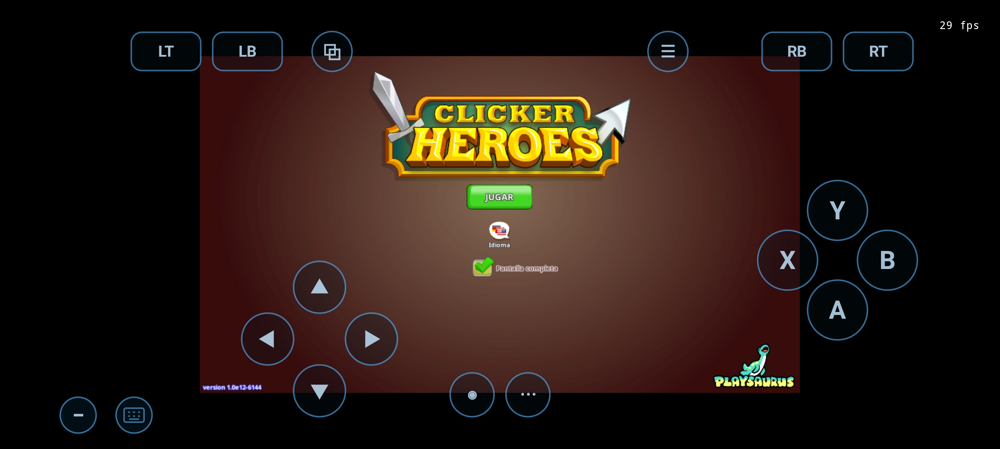
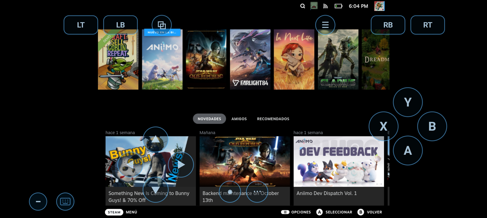
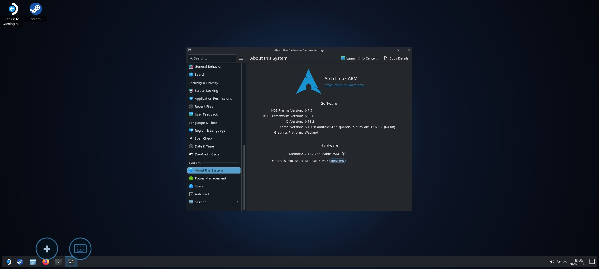

  <picture>
    <source media="(prefers-color-scheme: dark)" srcset="artwork/droiddeck-banner-dark.svg">
    
  </picture>

<h1 align="center">DroidDeck — Mali-G615 Experimental Fork</h1>

  <strong>SteamOS Gaming Mode (Gamescope + Big Picture), KDE Plasma Desktop &amp; Proton (ARM64EC + FEX / WOWBox64 + DXVK) on ARM Mali-G615 Android Devices</strong>

  
  
  

---

## 📖 Overview / Descripción General

**DroidDeck-Mali** is an experimental fork of [DroidDeck](https://github.com/Droid-Deck/DroidDeck) engineered to run **Valve's Steam client (Gaming Mode & Desktop Mode)** and **Windows games via ARM64EC Proton (`DroidDeck-Proton` / `GE-Proton`), `FEX-Emu`, `WOWBox64`, and `DXVK`** on **ARM Mali-G615 (Valhall v10)** Android devices without root (developed and tested on **POCO X6 Pro / MediaTek Dimensity 8300-Ultra — Mali-G615 MC6, 12 GB RAM**).

Upstream DroidDeck targets Qualcomm Adreno GPUs (`kgsl` + Mesa Turnip) and blocks Mali GPUs. This fork introduces:
- **Direct `/dev/mali0` (`mali_kbase`) Hardware Vulkan Support** using [`panvk-kbase-android`](https://github.com/zenithblue-oss/panvk-kbase-android) (`v0.1.0-rc3`) paired with DroidDeck's custom **ICD DRM primary-node shim** (`libvulkan_mali_g615_stub.so`) so `gamescope` and `DXVK` can initialize hardware Vulkan without a kernel DRM render node.
- **CPU Software Vulkan Safety Mode (`lavapipe`)** so sessions can also boot with `/dev/mali0` completely isolated from the container.
- **Unified Memory Architecture (UMA) & RAM Optimizations** tailored for 8–12 GB Android devices running Steam + Gamescope + Wine/Proton simultaneously.

---

## 📸 Screenshots / Pruebas en Hardware Real (Mali-G615 MC6)

### 1. In-Game Execution — *Clicker Heroes* (DirectX 11 → DXVK → PanVK-kbase on Mali-G615)
Running in Steam Gaming Mode at **29 FPS** (`29 fps` counter in top-right corner):

  

### 2. Steam Gaming Mode (Big Picture / Deck UI on Gamescope)
Full SteamOS Big Picture interface running inside `gamescope` on the phone:

  

### 3. KDE Plasma 6.7.5 Desktop Mode (`Mali-G615 MC6` Detected)
Full Arch Linux ARM64 KDE Plasma 6.7.5 Wayland desktop session detecting **`Mali-G615 MC6 (Integrated)`** as the graphics processor:

  

### 4. In-App GPU Drivers &amp; Components Manager (`Controladores de GPU`)
Selecting the **`Controlador Mali (experimental)`** mode and the imported **`DroidDeck Mali-G615 PanVK-kbase`** runtime driver alongside the native Android **`Vulkan del sistema (Mali)`** display presenter:

  

---

## 🚀 Download & Installation / Descarga e Instalación

Download the latest release from **[Releases](https://github.com/jdmg28/DroidDeck-Mali/releases/latest)**.

### 📦 Release Assets (Separate Files — Do Not Unpack the Driver ZIPs!)

> ⚠️ **IMPORTANT / IMPORTANTE:**
> Each GPU driver is published as its own **separate `.zip` file** on the release page:
> - **`DroidDeck-Mali-G615-PanVK-kbase-beta18.zip`** *(Hardware GPU driver for Mali-G615)*
> - **`DroidDeck-Software-Vulkan-lavapipe.zip`** *(CPU software Vulkan fallback driver)*
>
> **Do NOT extract these `.zip` files and do NOT bundle them inside another `.zip`.**
> Download the driver `.zip` you want and select that `.zip` file **directly** inside the DroidDeck app under **`Components` → `GPU drivers` → `Import`**.
>
> **NO descomprimas los archivos `.zip` de los drivers.** Descarga el archivo `.zip` del driver que necesites e impórtalo **directamente tal cual** dentro de la app DroidDeck en **`Components` → `GPU drivers` → `Import`**.

### Step-by-Step Setup / Pasos de Configuración

1. **Install the APK:**
   Download and install **`DroidDeck-Mali-G615-debug.apk`** (`versionCode 44`, `v0.3.2-exp1`).
2. **Disable Android Phantom Process Killer:**
   In Android **Developer options**, enable **Disable child process restrictions** (*Desactivar las restricciones de procesos secundarios*).
3. **Install the Linux Runtime:**
   Open DroidDeck and install the **Linux Runtime** (~3 GB) and optionally **Desktop & apps** (~1.1 GB).
4. **Import the GPU Driver `.zip` (Do NOT unzip it):**
   - Go to **`Components` → `GPU drivers` → `Import`** (or `Advanced` → `Runtime driver` → `Import`).
   - Select **`DroidDeck-Mali-G615-PanVK-kbase-beta18.zip`** for hardware GPU acceleration on Mali-G615 (`panvk-kbase-v0.1.0-rc3`).
   - *(Optional)* You can also import **`DroidDeck-Software-Vulkan-lavapipe.zip`** if you want a pure CPU software rendering profile.
5. **Enable Experimental Direct GPU Mode for Mali-G615:**
   - When launching **Steam Mode** or **Desktop Mode**, enable **Experimental direct GPU (`/dev/mali0`)** in the mode settings dialog so the container binds `/dev/mali0` and uses `PanVK-kbase`.

---

## 🔧 Key Engineering Changes in This Fork

| Subsystem | Problem on Mali-G615 Android | Solution Implemented in Build 44 |
|---|---|---|
| **Gamescope + `/dev/mali0`** | `gamescope` requires `VK_EXT_physical_device_drm` with a primary DRM node, which `mali_kbase` (`/dev/mali0`) does not expose. | Custom ICD adapter (`libvulkan_mali_g615_stub.so`) wraps `libpanvk_backend.so` (`panvk-kbase-v0.1.0-rc3`) and synthesizes `VK_EXT_physical_device_drm` from `/dev/mali0`'s `st_rdev`. |
| **DXVK UMA Heap Exhaustion** | `PanVK` reports `60%` of system RAM (`~6.6 GiB`) as `DEVICE_LOCAL`, causing DXVK to allocate `256 MiB` chunks and fail with `VK_ERROR_OUT_OF_DEVICE_MEMORY`. | Sets `heap_memory_percent=0.12` (`878 MiB` `< 896 MiB` threshold) so DXVK uses `64 MiB` chunks, paired with `dxvk.maxMemoryBudget=384`, `dxvk.enableMemoryDefrag=False`, and `dxvk.trackPipelineLifetime=False`. |
| **Shader Compilation Stutter** | Steam's x86_64 Fossilize layer and disabled Mesa cache caused shaders to recompile on every launch. | Upgraded to `panvk-kbase-v0.1.0-rc3` (3–5× faster compiler + Android/Linux disk cache), enabled persistent `MESA_SHADER_CACHE_DIR`, and disabled `VK_LAYER_VALVE_steam_fossilize_1`. |
| **Steam / CEF RAM Pressure** | `steamwebhelper` consumed `1.2–1.5 GB` RSS and repeatedly crashed trying to initialize `panvk` in CEF's GPU process. | Wrapped `steamwebhelper` with `--use-gl=disabled` and `VK_ICD_FILENAMES=/dev/null`, reducing `steamwebhelper` memory by ~1 GB with zero GPU process restarts. |
| **Android `lmkd` Container Kills** | Android's `lmkd` killed the entire proot container when a game spiked memory because all processes shared `oom_score_adj=0`. | `libblsession.so` (`tracer.c`) sets `oom_score_adj=200` on the Steam `reaper` process tree via raw `SYS_openat` so `lmkd` only terminates a runaway game, never the container. |
| **Wine Startup Hangs & RAM** | `nsiproxy.sys` hung on Android netlink (`errno 13`), and `explorer.exe` loaded `mesa zink` (`~296 MB` RSS). | Sets `WINEDLLOVERRIDES="...;nsiproxy.sys=d"` for instant network-probe fallback and `WINE_SKIP_OPENGL_GPU_PROBE=1` to keep `explorer.exe` lightweight. |
| **`WOWBox64` & `.wcp` Components** | `WOWBox64` was missing from the UI, `.wcp` XZ archives failed on `ZstdInputStream`, and `wowbox64.dll` lacks a Wine builtin signature. | Added `WOWBox64` tab, dual XZ/Zstd `.wcp` support, automatic staging of `wowbox64.dll` as `system32/libwow64fex.dll` (`libwow64fex=n,b`), and auto-healing of incompatible x86_64 `dxvk-1.x` packages. |

For detailed Spanish documentation on performance tuning and troubleshooting, see [`docs/optimizacion-rendimiento.md`](docs/optimizacion-rendimiento.md) and [`docs/modo-software.md`](docs/modo-software.md).

---

## 📜 Credits & License

- **Upstream Project:** [DroidDeck](https://github.com/Droid-Deck/DroidDeck) (built on WinNative and Bannerlator by [@maxjivi05](https://github.com/maxjivi05)).
- **Mali PanVK-kbase Backend:** [`panvk-kbase-android`](https://github.com/zenithblue-oss/panvk-kbase-android) by [@zenithblue-oss](https://github.com/zenithblue-oss).
- **Proton & Nightly Components:** [The412Banner/Nightlies](https://github.com/The412Banner/Nightlies) (`FEX`, `WOWBox64`, `DXVK`, `VKD3D-Proton`).
- **License:** GPL-3.0 — see [LICENSE](LICENSE). Steam and Proton are trademarks of Valve Corporation; this project is not affiliated with Valve.
